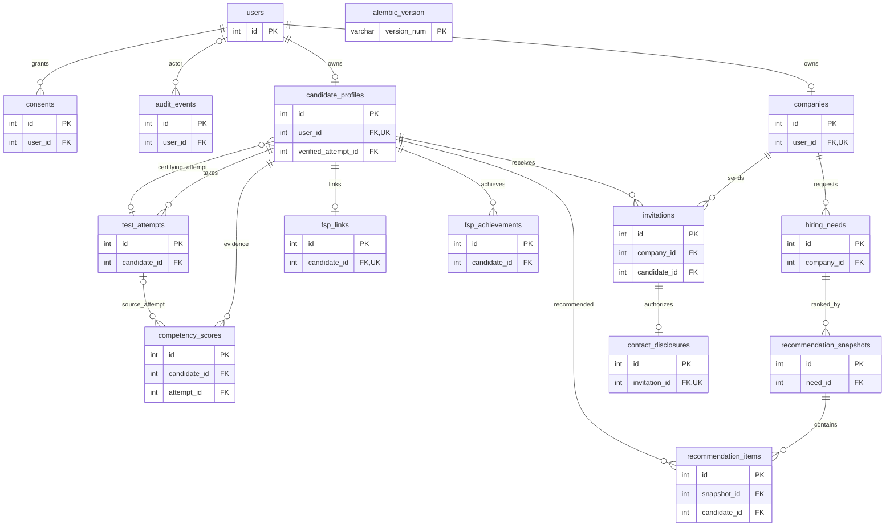

# PostgreSQL: структура «ФСП | ИТ-подбор»

Дата анализа: 2026-10-10. Описание текущего checkout по всем моделям
`services/api/app/models/*.py` и миграциям `services/api/alembic/versions/*.py`.
Это схема после применения head `0010`, а не новое обследование живой БД.
В рамках этой задачи подключение к БД, миграции и генерация данных не выполнялись.

## 1. Источники и миграции

`app/db/base.py` содержит общий `Base`; `app/models/__init__.py` импортирует все
14 моделей; `alembic/env.py` использует `Base.metadata`. Других доменных
`__tablename__` в Python-коде services/api не найдено. ORM `relationship()`
не объявлены: связи заданы ForeignKey и используются через запросы сервисов.

| Файл в alembic/versions | Revision → parent | Изменение |
|---|---|---|
| `17dada67f98e_init.py` | 17dada67f98e → нет | Пустая начальная миграция |
| `0002_domain.py` | 0002 → 17dada67f98e | Все 14 доменных таблиц, исходные FK/индексы/ограничения |
| `0003_candidate_profile.py` | 0003 → 0002 | Телефон, профессиональная роль, опыт, soft skills, self-declared grade |
| `0004_hiring_needs.py` | 0004 → 0003 | team_description, min_grade, optional_skills, nullable без выдуманного backfill |
| `0005_assessment_lifecycle.py` | 0005 → 0004 | Snapshot, версии/checksums, lifecycle, одна active attempt |
| `0006_assessment_result.py` | 0006 → 0005 | Сохранённый result JSON |
| `0007_recommendation_snapshot.py` | 0007 → 0006 | algorithm_version, weights, ordered_items |
| `0008_invitation_lifecycle.py` | 0008 → 0007 | NUMERIC зарплаты, Text предложения, contact_method/currency, active uniqueness |
| `0009_invitation_checks.py` | 0009 → 0008 | CHECK зарплат и RUB |
| `0010_assessment_v3.py` | 0010 → 0009 | Verified qualification, evidence, вариант C, diagnostic source |

0008 прекращает upgrade при дубликатах активных приглашений, не удаляя их;
0009 проверяет существующие строки, не исправляя их автоматически. 0010 не
подтверждает исторические профили; downgrade содержит защиту от потери v3 evidence.

## 2. Общие обозначения

- `NN` — NOT NULL; `NULL` — SQL NULL разрешён.
- Все доменные `id`: INTEGER, PK, NN, autoincrement (PostgreSQL sequence/serial).
  Генератор должен получать их от БД, а не назначать вручную.
- `VARCHAR` без заданной длины; `DOUBLE PRECISION` соответствует `sa.Double`
  миграции / Python float ORM; деньги — исключительно `NUMERIC(18,2)` / Decimal.
- `TIMESTAMPTZ` — `DateTime(timezone=True)`; `JSON` — именно JSON, не JSONB.
- `created_at` везде, где перечислен, NN с server default `now()`.
- `updated_at` NN с default `now()`; автоматическое обновление реализовано
  SQLAlchemy `onupdate=func.now()`, не PostgreSQL trigger. Прямой SQL UPDATE
  сам по себе время не обновляет.
- Все FK без явных ON DELETE/ON UPDATE CASCADE: действует стандартный NO ACTION.
  JSON-ссылки не являются FK. CHECK с nullable-полем допускает SQL NULL.
- JSON defaults `[]`/`{}` не проверяют форму содержимого: NOT NULL запрещает SQL NULL,
  но не JSON `null`. Типы/содержимое JSON в основном проверяются приложением.

## 3. Полный словарь таблиц и полей

### users — User (`models/user.py`)

| Поле | PostgreSQL | Обязательность / свойства |
|---|---|---|
| id | INTEGER | NN, PK, autoincrement |
| email | VARCHAR | NN, уникальный индекс ix_users_email |
| password_hash | VARCHAR | NN |
| role | VARCHAR | NN |
| is_verified | BOOLEAN | NN, default false |
| created_at | TIMESTAMPTZ | NN, default now() |

CHECK `ck_users_role`: `role IN ('candidate','employer')`.
Email не CITEXT, индекс не по lower(email): trim/lowercase — правило auth-сервиса,
не DB CHECK. Сам уникальный индекс не обеспечивает case-insensitive uniqueness.

### consents — Consent (`models/user.py`)

| Поле | PostgreSQL | Обязательность / свойства |
|---|---|---|
| id | INTEGER | NN, PK, autoincrement |
| user_id | INTEGER | NN, FK users.id |
| kind | VARCHAR | NN |
| granted | BOOLEAN | NN, default false |
| granted_at | TIMESTAMPTZ | NULL |
| created_at | TIMESTAMPTZ | NN, default now() |

UNIQUE `uq_consents_user_kind(user_id,kind)`.
CHECK `ck_consents_kind`: `kind IN ('terms','privacy','publish_profile')`.
API processing соответствует kind=privacy; publication — kind=publish_profile.
Это текущая запись согласия, а не append-only журнал всех его изменений.

### audit_events — AuditEvent (`models/user.py`)

| Поле | PostgreSQL | Обязательность / свойства |
|---|---|---|
| id | INTEGER | NN, PK, autoincrement |
| user_id | INTEGER | NULL, FK users.id, actor |
| action | VARCHAR | NN |
| payload | JSON | NULL, none_as_null=True |
| created_at | TIMESTAMPTZ | NN, default now() |

Invitation ID и переход статуса хранятся в payload; отдельного invitation_id FK нет.
Нет DB UNIQUE на действие или CHECK набора action.

### candidate_profiles — CandidateProfile (`models/candidate.py`)

| Поле | PostgreSQL | Обязательность / свойства |
|---|---|---|
| id | INTEGER | NN, PK, autoincrement |
| user_id | INTEGER | NN, FK users.id, UNIQUE |
| full_name | VARCHAR | NULL |
| stack | JSON | NN, default [] |
| grade | VARCHAR | NULL, legacy grade |
| specialization | VARCHAR | NULL, поле профиля |
| phone | VARCHAR | NULL |
| professional_role | VARCHAR | NULL |
| experience_months | INTEGER | NULL |
| soft_skills | JSON | NN, default [] |
| self_declared_grade | VARCHAR | NULL |
| privacy_settings | JSON | NN, default {} |
| verified_grade | VARCHAR | NULL |
| verified_specialization | VARCHAR | NULL |
| verified_attempt_id | INTEGER | NULL, FK test_attempts.id, fk_candidate_verified_attempt |
| last_grade_change_at | TIMESTAMPTZ | NULL |
| created_at | TIMESTAMPTZ | NN, default now() |
| updated_at | TIMESTAMPTZ | NN, default now(), ORM onupdate |

CHECK `ck_candidate_profiles_grade`: `grade IN ('junior','middle','senior')`.
CHECK `ck_candidate_verified_grade`: аналогичный набор для verified_grade.
Нет DB CHECK для self_declared_grade, опыта, каталога specialization или JSON skills.
Email находится только в users. publish_profile/show_contacts — ключи privacy_settings,
не отдельные колонки. Отсутствующий show_contacts трактуется сервисом как false.
Verified pointer не UNIQUE; соответствие attempt своему кандидату и успешному
результату проверяется `assessments/qualification.py`, не самим FK.

### companies — Company (`models/company.py`)

| Поле | PostgreSQL | Обязательность / свойства |
|---|---|---|
| id | INTEGER | NN, PK, autoincrement |
| user_id | INTEGER | NN, FK users.id, UNIQUE |
| name | VARCHAR | NN |
| description | TEXT | NULL |
| contacts | JSON | NULL, none_as_null=True |
| created_at | TIMESTAMPTZ | NN, default now() |

Один владелец на компанию и не более одной компании на пользователя. Таблицы
участников компании нет. FK сам по себе не проверяет role=employer.

### hiring_needs — HiringNeed (`models/company.py`)

| Поле | PostgreSQL | Обязательность / свойства |
|---|---|---|
| id | INTEGER | NN, PK, autoincrement |
| company_id | INTEGER | NN, FK companies.id |
| title | VARCHAR | NULL |
| stack | JSON | NN, default [], API requiredSkills |
| grade | VARCHAR | NULL, API targetGrade |
| specialization | VARCHAR | NULL |
| team_description | TEXT | NULL, API teamDescription |
| min_grade | VARCHAR | NULL, API minGrade |
| optional_skills | JSON | NULL, none_as_null=True, API optionalSkills |
| created_at | TIMESTAMPTZ | NN, default now() |

UNIQUE `uq_hiring_needs_company_title(company_id,title) NULLS NOT DISTINCT`:
в одной компании также нельзя иметь две строки с NULL title. Между компаниями
одинаковые title допустимы. Проверка каталога, порядка grades, повторов и пересечений
skills — API/service, не DB CHECK. Legacy nullable-строки могут не проходить API/ranking.

### test_attempts — TestAttempt (`models/candidate.py`)

| Поле | PostgreSQL | Обязательность / свойства |
|---|---|---|
| id | INTEGER | NN, PK, autoincrement |
| candidate_id | INTEGER | NN, FK candidate_profiles.id |
| test_id | VARCHAR | NN, идентификатор файлового blueprint, не FK |
| answers | JSON | NN, default [] |
| score | DOUBLE PRECISION | NULL |
| result | JSON | NULL, none_as_null=True |
| grade | VARCHAR | NULL, legacy |
| specialization | VARCHAR | NULL |
| requested_grade | VARCHAR | NULL |
| blueprint_version | VARCHAR | NULL |
| catalog_version | VARCHAR | NULL |
| blueprint_checksum | VARCHAR | NULL |
| catalog_checksum | VARCHAR | NULL |
| snapshot_schema_version | INTEGER | NULL |
| snapshot | JSON | NULL, none_as_null=True |
| variant | VARCHAR | NULL |
| status | VARCHAR | NN, default legacy |
| submitted_at | TIMESTAMPTZ | NULL |
| created_at | TIMESTAMPTZ | NN, default now() |

CHECK: `ck_test_attempts_status`: legacy/active/submitted;
`ck_test_attempts_variant`: A/B/C.
Частичный уникальный индекс `uq_test_attempts_active_candidate(candidate_id)
WHERE status = 'active'` запрещает две активные попытки любого типа у кандидата.
Snapshot содержит внутренние вопросы/ключи/правила; публичная сериализация должна
использовать allowlist DTO. Immutable snapshot, one-time submit и cooldown — сервисные
гарантии, DB trigger отсутствует. Legacy snapshot может оставаться NULL.

### competency_scores — CompetencyScore (`models/candidate.py`)

| Поле | PostgreSQL | Обязательность / свойства |
|---|---|---|
| id | INTEGER | NN, PK, autoincrement |
| candidate_id | INTEGER | NN, FK candidate_profiles.id |
| competency | VARCHAR | NN |
| score | DOUBLE PRECISION | NN |
| source | VARCHAR | NN |
| evidence_count | INTEGER | NULL |
| blueprint_version | VARCHAR | NULL |
| attempt_id | INTEGER | NULL, FK test_attempts.id |
| created_at | TIMESTAMPTZ | NN, default now() |

UNIQUE `uq_competency_scores_candidate_competency_source(candidate_id,competency,source)`.
CHECK `ck_competency_scores_source`: test/fsp/manual/assessment_diagnostic.
Нет DB CHECK диапазона score/evidence_count. Это обновляемая сводка evidence, не
неизменяемая история каждой попытки. Владение attempt проверяет приложение.

### fsp_links — FspLink (`models/fsp.py`)

| Поле | PostgreSQL | Обязательность / свойства |
|---|---|---|
| id | INTEGER | NN, PK, autoincrement |
| candidate_id | INTEGER | NN, FK candidate_profiles.id, UNIQUE |
| fsp_id | VARCHAR | NULL, UNIQUE |
| linked_at | TIMESTAMPTZ | NULL |
| status | VARCHAR | NN, default no_history |

CHECK `ck_fsp_links_status`: linked/no_history. Обычный UNIQUE fsp_id допускает
несколько SQL NULL. created_at здесь нет. linked не является доказательством
экспертно подтверждённой квалификации/достоверности достижения.

### fsp_achievements — FspAchievement (`models/fsp.py`)

| Поле | PostgreSQL | Обязательность / свойства |
|---|---|---|
| id | INTEGER | NN, PK, autoincrement |
| candidate_id | INTEGER | NN, FK candidate_profiles.id |
| discipline | VARCHAR | NN |
| competition | VARCHAR | NULL |
| result | VARCHAR | NULL |
| role | VARCHAR | NULL |
| rank | VARCHAR | NULL, строка, не rank рекомендаций |
| created_at | TIMESTAMPTZ | NN, default now() |

UNIQUE `uq_fsp_achievements_candidate_discipline_competition(candidate_id,discipline,competition)
NULLS NOT DISTINCT`. FK к fsp_links нет; наличие link не является DB prerequisite
для achievement. Отдельных verified/provenance/evidence-document колонок нет.

### recommendation_snapshots — RecommendationSnapshot (`models/recommendation.py`)

| Поле | PostgreSQL | Обязательность / свойства |
|---|---|---|
| id | INTEGER | NN, PK, autoincrement |
| need_id | INTEGER | NN, FK hiring_needs.id |
| algorithm_version | VARCHAR | NULL |
| weights | JSON | NULL, none_as_null=True |
| ordered_items | JSON | NULL, none_as_null=True |
| created_at | TIMESTAMPTZ | NN, default now() |

JSON сохраняет порядок, scores, components, причины и безопасные candidate references.
FK для candidate IDs внутри JSON нет. Новые snapshots одновременно создают нормализованные
recommendation_items; согласованность двух представлений обеспечивает сервис.
Legacy nullable payload читается через items. Immutable обеспечивается сервисом, не trigger.
base snapshot ID в Talent Bank — id этой таблицы, отдельной таблицы фильтров нет.

### recommendation_items — RecommendationItem (`models/recommendation.py`)

| Поле | PostgreSQL | Обязательность / свойства |
|---|---|---|
| id | INTEGER | NN, PK, autoincrement |
| snapshot_id | INTEGER | NN, FK recommendation_snapshots.id |
| candidate_id | INTEGER | NN, FK candidate_profiles.id |
| score | DOUBLE PRECISION | NN |
| reason | TEXT | NULL |
| rank | INTEGER | NULL |

Нет created_at, UNIQUE(snapshot_id,candidate_id), UNIQUE(snapshot_id,rank) или CHECK
диапазона score/rank. Детерминированную сортировку и отсутствие повторов обеспечивает код.

### invitations — Invitation (`models/invitation.py`)

| Поле | PostgreSQL | Обязательность / свойства |
|---|---|---|
| id | INTEGER | NN, PK, autoincrement |
| company_id | INTEGER | NN, FK companies.id |
| candidate_id | INTEGER | NN, FK candidate_profiles.id |
| title | TEXT | NULL, API offerDescription |
| contact_method | VARCHAR | NULL, API contactMethod |
| currency | VARCHAR | NULL для legacy; новые API requests RUB |
| salary_from | NUMERIC(18,2) | NN, API salaryMin |
| salary_to | NUMERIC(18,2) | NN, API salaryMax |
| status | VARCHAR | NN, default sent |
| created_at | TIMESTAMPTZ | NN, default now() |
| updated_at | TIMESTAMPTZ | NN, default now(), ORM onupdate |

CHECK:

- `ck_invitations_status`: `status IN ('sent','viewed','accepted','rejected')`.
  API declined соответствует DB rejected.
- `ck_invitations_salary_positive`: `salary_from > 0 AND salary_from <> 'NaN'::numeric`.
- `ck_invitations_salary_range`: `salary_to >= salary_from AND salary_to <> 'NaN'::numeric`.
- `ck_invitations_currency`: `currency = 'RUB'`; SQL NULL остаётся допустимым для legacy.

Частичный UNIQUE index `uq_invitations_active_pair(company_id,candidate_id)
WHERE status IN ('sent','viewed')`. Terminal приглашения не запрещают будущие
приглашения этой пары. need_id отсутствует. CHECK ограничивает набор статусов,
но не переходы/terminal immutability: это responsibility invitation service с row locks.

### contact_disclosures — ContactDisclosure (`models/invitation.py`)

| Поле | PostgreSQL | Обязательность / свойства |
|---|---|---|
| id | INTEGER | NN, PK, autoincrement |
| invitation_id | INTEGER | NN, FK invitations.id, UNIQUE |
| revealed_at | TIMESTAMPTZ | NN, default now() |

Candidate и origin company определяются через invitation. Email/phone здесь не
копируются. Запись истории disclosure не заменяет проверку актуальных privacy/consents.
DB сама не проверяет accepted; создание вместе с accept и audit выполняет сервис.

### alembic_version — служебная таблица Alembic

| Поле | PostgreSQL | Обязательность / свойства |
|---|---|---|
| version_num | VARCHAR(32) | NN, PK alembic_version_pkc |

Создаётся Alembic, не SQLAlchemy-доменной моделью. Для текущей линейной цепочки
содержит revision head `0010` после полного upgrade. FK нет. Генератор аккаунтов
не должен читать её как бизнес-данные или изменять.

## 4. Индексы, кратности и границы гарантий БД

Помимо PK и UNIQUE из словаря, обычные индексы `ix_<table>_<column>` есть на:
consents.user_id, competency_scores.candidate_id, fsp_achievements.candidate_id,
hiring_needs.company_id, invitations.company_id и candidate_id,
test_attempts.candidate_id, recommendation_snapshots.need_id,
recommendation_items.snapshot_id и candidate_id. audit_events.user_id,
verified_attempt_id и competency_scores.attempt_id не получают отдельный обычный
индекс автоматически от ForeignKey.

| Родитель → дочерняя таблица | Кратность / FK |
|---|---|
| users → candidate_profiles | 1 → 0..1, user_id UNIQUE NN |
| users → companies | 1 → 0..1, user_id UNIQUE NN |
| users → consents | 1 → 0..N, user_id NN; максимум одна запись каждого kind |
| users → audit_events | 1 → 0..N; event может иметь 0..1 actor |
| companies → hiring_needs | 1 → 0..N, company_id NN |
| companies → invitations | 1 → 0..N, company_id NN |
| candidate_profiles → test_attempts | 1 → 0..N, candidate_id NN |
| test_attempts → candidate_profiles | 1 → 0..N на уровне FK verified_attempt_id; у profile 0..1 proof |
| candidate_profiles → competency_scores | 1 → 0..N, candidate_id NN |
| test_attempts → competency_scores | 1 → 0..N; score имеет 0..1 attempt |
| candidate_profiles → fsp_links | 1 → 0..1, candidate_id UNIQUE NN |
| candidate_profiles → fsp_achievements | 1 → 0..N, candidate_id NN |
| hiring_needs → recommendation_snapshots | 1 → 0..N, need_id NN |
| recommendation_snapshots → recommendation_items | 1 → 0..N, snapshot_id NN |
| candidate_profiles → recommendation_items | 1 → 0..N, candidate_id NN |
| candidate_profiles → invitations | 1 → 0..N, candidate_id NN |
| invitations → contact_disclosures | 1 → 0..1, invitation_id UNIQUE NN |

Цикл profile → verified attempt → profile требует сначала создать профиль без proof,
затем попытку и только затем закрепить квалификацию. DB не запрещает пользователю
иметь одновременно company и candidate_profile и не проверяет роль владельца этих
строк; API/RBAC запрещает неподходящие операции. Семантически proof обязан принадлежать
тому же кандидату, хотя отдельный FK этого не доказывает.

## 5. ER-диаграмма

Показаны ключи и связи; полный набор атрибутов — в словаре выше. Кардинальности
отражают DB constraints, а не более строгие правила сервисов.

## 6. Группировка по подсистемам

| Подсистема | Таблицы |
|---|---|
| Identity/auth | users; JWT не хранятся отдельной таблицей |
| Кандидаты/privacy | candidate_profiles, consents; email в users |
| Работодатели | companies, hiring_needs; роль/учётная запись в users |
| Тестирование | test_attempts, competency_scores, verified-поля candidate_profiles |
| ФСП | fsp_links, fsp_achievements |
| Рекомендации/Talent Bank | recommendation_snapshots, recommendation_items; reads candidate/consent/attempt |
| Приглашения/контакты | invitations, contact_disclosures, audit_events; reads users/consents/privacy |
| Миграции | alembic_version |

Нет отдельных DB-таблиц questions, blueprints, catalog, grades, skills, qualifications,
sessions, refresh_tokens или talent_bank. Каталог и blueprints — versioned JSON в
`app/data/catalog/`, manifest/checksums загружает `modules/catalog/repository.py`.
Сохранённый snapshot attempt содержит нужную историческую версию контента.

## 7. Что нужно для 100 синтетических аккаунтов

Это план будущей генерации, не выполненная операция и не предложение менять схему.
100 аккаунтов означает 100 users, а не 100 строк суммарно. Распределение ролей нужно
выбрать заранее; например, 80 кандидатов + 20 работодателей — только вариант, не
существующее требование или факт текущей БД.

### Минимальные данные и порядок

1. Выделить изолированную тестовую БД с согласованной схемой head 0010. До записи
   проверить целевое подключение; не использовать dev/общую БД без разрешения.
2. Подготовить versioned fixture и отдельный manifest запуска: seed случайности,
   префикс набора, распределение ролей, email → созданные IDs, версии каталога.
   Новая DB-таблица для этого не нужна. Такой manifest не должен содержать пароли/JWT.
3. Создать users с уникальными нормализованными email вида
   `synthetic-<batch>-001@example.test`, role candidate/employer и Argon2id
   через существующий `modules/auth/security.py:hash_password()`.
   Не использовать настоящие контакты, plaintext passwords или общий пароль production.
   is_verified по умолчанию false; для E2E подтверждать через штатный email flow
   с локальным Mailpit. Прямая установка true допустима лишь как явно тестовая fixture
   в изолированной среде, не как подтверждение реального пользователя.
4. Кандидатам создать candidate_profiles с user_id полученного users.id,
   синтетическим именем, canonical specialization/skills из CatalogRepository.
   grade/self_declared_grade не считать verified. verified_* и last_grade_change_at
   оставить NULL. Телефон можно не заполнять. Не путать user ID с profile ID.
5. Создать только явно заданные consents на (user_id,kind). processing=privacy,
   publication=publish_profile. По умолчанию не давать согласия автоматически;
   разрешённые тестовые сценарии описать в fixture отдельно. Согласовать publication
   с privacy_settings.publish_profile; show_contacts по умолчанию false.
6. Работодателям создать companies с уникальным user_id; затем hiring_needs по
   company_id. Для работоспособного API/ranking заполнить title, specialization,
   min_grade, grade=targetGrade, stack=requiredSkills, optional_skills,
   team_description. Соблюдать canonical IDs, minGrade ≤ targetGrade по catalog order,
   отсутствие повторов/пересечений навыков и уникальность title внутри компании.
7. FspLink необязателен; если нужен сценарий отсутствия истории — no_history,
   fsp_id/linked_at NULL. Не создавать фиктивные trusted достижения. Наличие seed
   achievement или linked не делает их подтверждёнными для ranking.
8. Attempts создавать через штатный assessment service/API, сохраняющий snapshot,
   версии/checksums и выбранный вариант. Не изобретать исторические snapshots и не
   записывать proof вручную. Result/CompetencyScore/verified pointer формирует submit.
9. Snapshots и invitations создавать через соответствующие сервисы, только после
   eligibility. RecommendationItems должны соответствовать ordered_items.
   Accept атомарно создаёт accepted + ContactDisclosure + AuditEvent.
   Не вставлять grants для sent/viewed/rejected и не заполнять audit фиктивной историей.

### Границы реалистичности набора

- Квалификация определяется баллом (13/18 pass + per-skill ≥50%, 16/18 high + ≥70%),
  а не флагом demo/approved. Успешная v3-попытка даёт verified qualification при
  выполнении остальных hard gates.
- Для положительного сценария нужны: успешный submit, verified email, publication и
  publish_profile, совпадение verified specialization и minGrade. Самозаявленные
  поля/seed scores не заменяют proof.
- Контакты требуют origin employer, accepted invitation, его disclosure и актуальные
  verified email, processing/publication, publish_profile, show_contacts. Генерация
  записи disclosure сама по себе не разрешает выдачу контактов.
- Тест-фикстуры integration tests используют изолированные копии каталога и не
  должны попадать в реальный каталог/профили.
- Текущий `app/commands/seed_demo.py` идемпотентен через `_ensure()` и использует
  `hash_password()`, но это фиксированный demo seed, не генератор 100 аккаунтов.
  Он не создаёт достоверную verified qualification; повторно его здесь не запускали.

### Проверки безопасного генератора

- До записи валидировать весь fixture, canonical IDs, Decimal зарплаты, связи и
  уникальные ключи; записи создавать транзакционно. Не допускать частичного набора.
- Идемпотентность по выделенному batch email и существующим UNIQUE. При совпадении
  с чужим аккаунтом остановиться; не перезаписывать пароль/роль/согласия пользователя.
- Учитывать NULLS NOT DISTINCT, один active attempt и одно active invitation на пару.
- После генерации проверить ровно 100 новых batch users, соответствие ролей профилям,
  отсутствие потерянных FK, отсутствие ложных verified-полей, отсутствие PII в публичных DTO.
- Хранить provenance набора вне бизнес-таблиц: нет существующего is_synthetic/batch_id.
  Очистка, если позже разрешена, только по manifest созданных IDs с учётом FK и цикла
  profile/attempt, никогда через общий reset, truncate или совпадение произвольного имени.

## 8. Предлагаемые изменения

В рамках документа изменения схемы **не предлагаются и не применялись**.
Будущий генератор/fixture manifest — отдельная задача после выбора распределения
100 аккаунтов, целевой изолированной среды и набора сценариев. Указанные пробелы
DB constraints описывают фактическую границу между БД и сервисом, а не разрешение
на добавление миграций или обход бизнес-правил.
